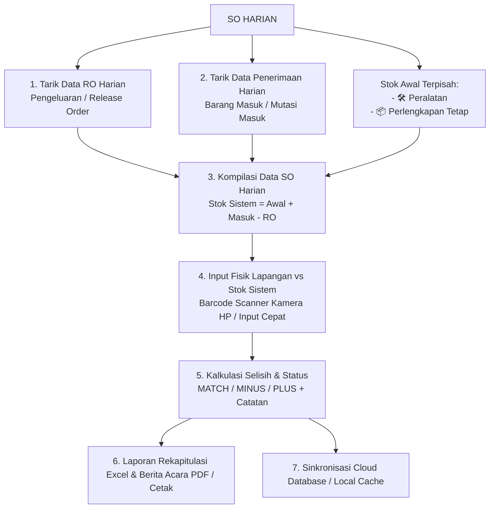

# Panduan Struktur & Integrasi Sistem SO Harian (Stock Opname)

Dokumen ini berisi dokumentasi teknis lengkap mengenai arsitektur, skema data, logika bisnis, dan dependensi sistem **SO Harian**, yang dirancang agar dapat **diintegrasikan dengan mudah ke dalam aplikasi web lain** (seperti portal ERP, Dashboard WMS, atau sistem manajemen aset gudang).

---

## 1. Ringkasan Sistem & Alur Kerja

Sistem SO Harian mengotomatiskan proses rekonsiliasi stok fisik harian dengan alur:



---

## 2. Dependensi (Libraries / Packages)

Jika Anda ingin menggabungkan modul ini ke proyek web lain, pastikan dependensi berikut terpasang:

```json
{
  "dependencies": {
    "react": "^18.3.1",
    "react-dom": "^18.3.1",
    "xlsx": "https://cdn.sheetjs.com/xlsx-0.20.3/xlsx-0.20.3.tgz",
    "html5-qrcode": "^2.3.8",
    "@supabase/supabase-js": "^2.48.1",
    "lucide-react": "^0.475.0",
    "clsx": "^2.1.1",
    "tailwind-merge": "^3.0.1"
  }
}
```

**Perintah instalasi:**
```bash
npm install https://cdn.sheetjs.com/xlsx-0.20.3/xlsx-0.20.3.tgz html5-qrcode @supabase/supabase-js lucide-react clsx tailwind-merge
```

---

## 3. Pohon Struktur Berkas & Tanggung Jawab

```
SO HARIAN/
├── src/
│   ├── components/
│   │   ├── UploadSection.jsx         # Langkah 1: Upload RO, Penerimaan, & Stok Awal 2 Kategori
│   │   ├── DataPreviewModal.jsx      # Modal pratinjau data Excel sebelum diproses
│   │   ├── PhysicalCountTable.jsx    # Langkah 2: Tabel PC & kartu HP input fisik, filter kategori, status
│   │   ├── BarcodeScannerModal.jsx   # Scanner kamera barcode HP/PC (html5-qrcode)
│   │   ├── NotesModal.jsx            # Modal catatan investigasi & preset alasan selisih
│   │   ├── SummaryCards.jsx          # Kartu KPI & akurasi stok (global & per kategori)
│   │   ├── HistorySection.jsx        # Langkah 3: Arsip riwayat sesi SO & ekspor
│   │   ├── ReportPrintView.jsx       # Layout dokumen Berita Acara resmi (khusus cetak/PDF)
│   │   └── CloudSettingsModal.jsx    # Modal pengaturan Supabase Cloud Database
│   ├── services/
│   │   └── storageService.js         # Layer penyimpanan ganda: LocalStorage + Supabase Cloud
│   ├── utils/
│   │   ├── inventoryEngine.js        # Mesin kalkulasi stok sistem, selisih, & akurasi
│   │   └── excelService.js           # Parser Excel, generator template bawaan, & export XLSX
│   ├── App.jsx                       # Komponen root aplikasi & router tab
│   ├── index.css                     # Utility styling Tailwind & print rules
│   └── main.jsx
├── tests/
│   ├── inventoryEngine.test.js       # Pengujian unit kalkulasi & kategori
│   ├── excelService.test.js          # Pengujian unit parsing & export Excel
│   └── storageService.test.js        # Pengujian unit penyimpanan & cloud config
└── supabase_schema.sql               # Skrip inisialisasi tabel database PostgreSQL
```

---

## 4. Skema Database (PostgreSQL / Supabase)

Terdapat 2 tabel relasional yang digunakan:

```sql
-- 1. Header Sesi SO Harian
CREATE TABLE IF NOT EXISTS public.so_sessions (
    id TEXT PRIMARY KEY,
    tanggal DATE NOT NULL DEFAULT CURRENT_DATE,
    gudang VARCHAR(100) DEFAULT 'Gudang Utama',
    petugas VARCHAR(100) DEFAULT 'Petugas Gudang',
    total_items INTEGER DEFAULT 0,
    item_match INTEGER DEFAULT 0,
    item_selisih INTEGER DEFAULT 0,
    akurasi_persen NUMERIC(5,2) DEFAULT 0.00,
    status VARCHAR(50) DEFAULT 'DRAFT',
    created_at TIMESTAMPTZ DEFAULT NOW(),
    updated_at TIMESTAMPTZ DEFAULT NOW()
);

-- 2. Detail Item Barang SO Harian
CREATE TABLE IF NOT EXISTS public.so_details (
    id TEXT PRIMARY KEY,
    session_id TEXT REFERENCES public.so_sessions(id) ON DELETE CASCADE,
    kode_barang VARCHAR(100) NOT NULL,
    nama_barang VARCHAR(255),
    kategori VARCHAR(100) DEFAULT 'Peralatan', -- 'Peralatan' | 'Perlengkapan Tetap'
    satuan VARCHAR(50) DEFAULT 'PCS',
    stok_awal NUMERIC(12,2) DEFAULT 0,
    qty_penerimaan NUMERIC(12,2) DEFAULT 0,
    qty_ro NUMERIC(12,2) DEFAULT 0,
    stok_sistem NUMERIC(12,2) DEFAULT 0,
    qty_fisik NUMERIC(12,2),
    selisih NUMERIC(12,2),
    status_selisih VARCHAR(50) DEFAULT 'UNCHECKED', -- 'MATCH' | 'MINUS' | 'PLUS' | 'UNCHECKED'
    catatan TEXT,
    created_at TIMESTAMPTZ DEFAULT NOW(),
    updated_at TIMESTAMPTZ DEFAULT NOW()
);

-- Indexing
CREATE INDEX IF NOT EXISTS idx_so_sessions_tanggal ON public.so_sessions(tanggal DESC);
CREATE INDEX IF NOT EXISTS idx_so_details_session_id ON public.so_details(session_id);
CREATE INDEX IF NOT EXISTS idx_so_details_kode_barang ON public.so_details(kode_barang);
```

---

## 5. Logika Bisnis & Formula Inti (`src/utils/inventoryEngine.js`)

Semua logika kalkulasi terisolasi murni (*pure functions*) sehingga dapat digunakan di backend Node.js maupun frontend mana pun.

### 5.1. Formula Stok Sistem
```javascript
export function calculateSystemStock(stokAwal, qtyPenerimaan, qtyRo) {
  const awal = Number(stokAwal) || 0
  const masuk = Number(qtyPenerimaan) || 0
  const keluar = Number(qtyRo) || 0
  const hasil = awal + masuk - keluar
  return Math.round((hasil + Number.EPSILON) * 10000) / 10000
}
```

### 5.2. Formula Selisih & Status
```javascript
export function calculateVariance(qtyFisik, stokSistem) {
  if (qtyFisik === null || qtyFisik === undefined || qtyFisik === '') {
    return { selisih: null, status: 'UNCHECKED' }
  }
  const fisik = Number(qtyFisik)
  const sistem = Number(stokSistem) || 0
  const selisih = Math.round((fisik - sistem + Number.EPSILON) * 10000) / 10000

  let status = 'MATCH'
  if (selisih < 0) status = 'MINUS'
  else if (selisih > 0) status = 'PLUS'

  return { selisih, status }
}
```

### 5.3. Formula Akurasi Stok
$$\text{Akurasi Global (\%)} = \frac{\text{Jumlah Item MATCH}}{\text{Total Item yang Sudah Dihitung}} \times 100\%$$

Sistem juga menghitung akurasi secara independen untuk masing-masing kategori:
- **Akurasi Peralatan (%)**
- **Akurasi Perlengkapan Tetap (%)**

---

## 6. Pengolahan File Excel (`src/utils/excelService.js`)

Modul ini menangani:
1. **Normalisasi Header Otomatis**: Mendeteksi otomatis variasi penamaan kolom (misal: `Kode Item`, `SKU`, `Kode` $\rightarrow$ otomatis dinormalisasi menjadi `kode_barang`).
2. **Template Download Bawaan**:
   - `generateSampleTemplate('RO')`
   - `generateSampleTemplate('PENERIMAAN')`
   - `generateSampleTemplate('STOK_AWAL_PERALATAN')`
   - `generateSampleTemplate('STOK_AWAL_PERLENGKAPAN')`
3. **Ekspor Laporan SO ke XLSX**:
   - `exportSoReportToExcel(sessionData, items)` menghasilkan file Excel berisi 2 sheet:
     - **Sheet 1 ("Ringkasan SO")**: Metadata tanggal, gudang, petugas, dan rekap metrik.
     - **Sheet 2 ("Rincian SO Harian")**: Tabel detail lengkap kolom No, SKU, Nama, Kategori, Satuan, Stok Awal, Masuk, RO, Stok Sistem, Fisik SO, Selisih, Status, dan Catatan.

---

## 7. Cara Menggabungkan (Integrasi) ke Web Lain

### Skenario A: Menggabungkan Sebagai 1 Halaman / Rute Mandiri (Misal: `/stock-opname`)

Cukup copy folder `src/components/`, `src/services/`, dan `src/utils/` ke dalam proyek Anda, lalu panggil komponen utama di rute halaman Anda:

```jsx
// Contoh di Next.js (pages/stock-opname.jsx atau app/stock-opname/page.jsx)
// atau React Router:
import React from 'react'
import SOApp from '../modules/so-harian/App'

export default function StockOpnamePage() {
  return (
    <div className="w-full min-h-screen">
      <SOApp />
    </div>
  )
}
```

---

### Skenario B: Menggunakan Komponen Parsial ke Dashboard Anda yang Sudah Ada

Jika Anda sudah memiliki header dan navigasi sendiri, Anda bisa memanggil komponen-komponennya secara terpisah:

```jsx
import React, { useState } from 'react'
import UploadSection from './components/UploadSection'
import PhysicalCountTable from './components/PhysicalCountTable'
import SummaryCards from './components/SummaryCards'
import { exportSoReportToExcel, downloadBlob } from './utils/excelService'

export default function MyCustomInventoryView() {
  const [items, setItems] = useState([])

  const handleDataLoaded = (compiledItems) => {
    setItems(compiledItems)
  }

  const handleExport = () => {
    const blob = exportSoReportToExcel({ tanggal: '2026-10-14' }, items)
    downloadBlob(blob, 'Rekap_SO.xlsx')
  }

  return (
    <div className="p-6 space-y-6">
      {/* 1. Summary Cards */}
      {items.length > 0 && <SummaryCards items={items} />}

      {/* 2. Step Upload (Jika belum ada data) */}
      {items.length === 0 ? (
        <UploadSection onCompilationSuccess={handleDataLoaded} />
      ) : (
        /* 3. Tabel Input Fisik SO */
        <PhysicalCountTable items={items} onUpdateItems={setItems} />
      )}
    </div>
  )
}
```

---

## 8. Mode Cloud Sync vs Offline

Aplikasi ini menggunakan **Hybrid Storage (`src/services/storageService.js`)**:
1. **Default (Zero Setup)**: Menyimpan ke `localStorage` browser. Tim gudang dapat langsung bekerja tanpa internet dan tanpa backend.
2. **Multi-Device Cloud (Supabase)**: Cukup masukkan kredensial:
   - `VITE_SUPABASE_URL` / Input Modal Pengaturan.
   - `VITE_SUPABASE_ANON_KEY` / Input Modal Pengaturan.
   Maka data yang di-scan atau diinput di HP saat keliling rak gudang akan **langsung tersinkronisasi ke PC kasir/admin gudang**.
